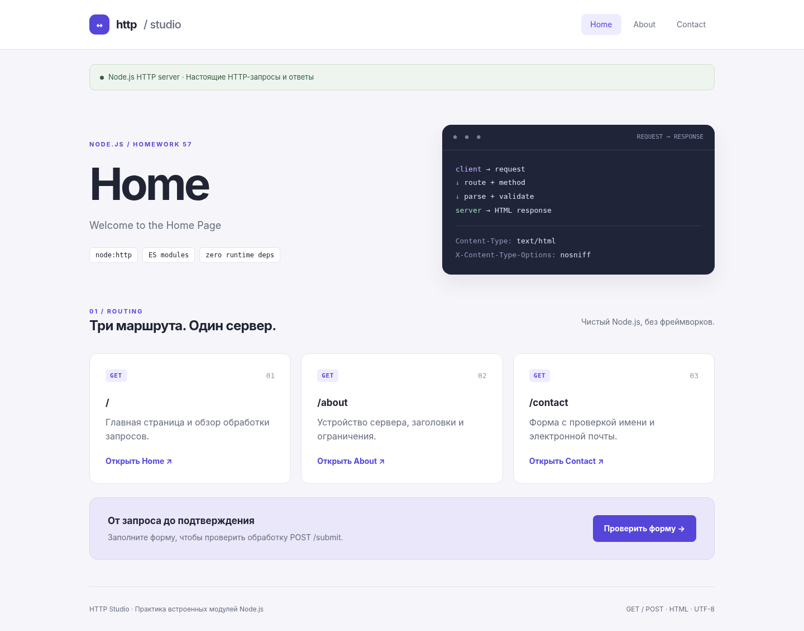

# HW 57 · HTTP Studio

HTTP-сервер на чистом Node.js: GET-маршруты, обработка HTML-формы и ошибки HTTP. Дополнительный статический режим подготовлен для GitHub Pages. Runtime-зависимостей нет.



## Запуск

Node.js 24 либо Node.js 22.12+. Из папки проекта:

```bash
code .
npm start
```

Откройте `http://localhost:3000/`. Установка npm-пакетов для запуска сервера не нужна. `npm run dev` запускает сервер с автоматическим перезапуском при изменениях. Остановка — Ctrl+C.

Другой порт в PowerShell:

```powershell
$env:PORT=3001
npm start
```

В bash: `PORT=3001 npm start`. Для возврата к стандартному порту в PowerShell: `Remove-Item Env:PORT`. `PORT=0` выбирает свободный порт и полезен для тестов. `HOST` необязателен; без него Node.js слушает доступные интерфейсы. Для доступа только с локального компьютера задайте `HOST=127.0.0.1`.

## Маршруты

| Метод и путь | Результат |
| --- | --- |
| `GET /` | 200, Home / Welcome to the Home Page |
| `GET /about` | 200, About / Learn more about us |
| `GET /contact` | 200, Contact / Get in touch и форма |
| `POST /submit` | 200, Form Submitted и полученные name/email |
| Неизвестный путь с GET/POST | 404, Page Not Found |
| Неподдерживаемый метод или неверный метод известного маршрута | 405, Method Not Allowed и Allow |
| Некорректная форма / неподходящий Content-Type | 400, Invalid form data |
| POST больше 16 KiB | 413, Payload Too Large |
| Неожиданная ошибка обработки | 500, Server Error |

Параметры query не меняют маршрут: `/about?ref=test` работает как `/about`. `HEAD` намеренно не включён в разрешённые методы основного сервера. Для такого запроса HTTP-слой не передаёт тело ответа.

Все HTML-ответы имеют `Content-Type: text/html; charset=utf-8`, точный `Content-Length` в байтах и `X-Content-Type-Options: nosniff`. Дополнительно установлены CSP, `Referrer-Policy` и запрет кэширования.

### Примеры curl

```bash
curl -i http://localhost:3000/
curl -i http://localhost:3000/about
curl -i http://localhost:3000/contact
curl -i -d "name=Alex&email=alex%40example.com" http://localhost:3000/submit
curl -i -d "name=&email=" http://localhost:3000/submit
curl -i http://localhost:3000/missing
curl -i -X PUT http://localhost:3000/
```

В Windows PowerShell используйте `curl.exe`, чтобы не вызвать старый псевдоним PowerShell. Корректная отправка возвращает `<h1>Form Submitted</h1>`, `Name: Alex`, `Email: alex@example.com`. Ошибка 500 проверяется тестом с принудительным сбоем парсера: публичного отладочного маршрута, специально вызывающего 500, нет.

## Валидация и ограничения

Ожидается `application/x-www-form-urlencoded`. Пробелы по краям имени/email удаляются. Имя обязательно и не длиннее 100 символов; email — до 254 символов, с непустыми частями до/после `@` и точкой в домене. Повторяющиеся name/email отклоняются. Дополнительные поля игнорируются. Объём тела ограничен 16 384 байтами как по Content-Length, так и при chunked-передаче. Весь ввод экранируется перед вставкой в HTML.

Форма ничего не отправляет по электронной почте и не сохраняет данные. Это учебный HTTP-сервер, а не готовая система пользователей: нет БД, аутентификации, TLS, rate limiting и CSRF-токенов. На серверном хостинге HTTPS и дополнительные меры безопасности настраиваются отдельно. Таймаут получения запроса — 15 секунд, заголовков — 10 секунд.

## Тесты

Без зависимостей:

```bash
npm run test:native
npm run build
```

Исходные тесты и полная проверка:

```bash
npm install
npm run check
npm run test:coverage
npx playwright install chromium
npm run test:browser
npm run test:report
```

**Перед `npm test`, `npm run check` и `npm run test:report` остановите сервер на порту 3000:** исходный тест использует именно этот порт. Настройка Vitest принудительно выставляет PORT=3000. `npm run test:native` и браузерные сценарии используют случайные свободные порты.

`npm run test:report` сохраняет фактический вывод Vitest в `reports/test-output.txt`, HTML в `reports/test-report.html` и, при доступном Chromium, скриншот `reports/tests.png`. `npm run test:report:native` делает аналогичный отчёт именно нативных тестов. Проверка `npm run check` включает синтаксис/JSON, node:test, Vitest и сборку; отдельный ESLint не установлен.

Статус выполненных и неподтверждённых проверок: [VERIFICATION.md](docs/VERIFICATION.md).

## GitHub Pages и демо

```bash
npm run build
npm run preview
```

Откройте `http://127.0.0.1:4173/`. Для одновременного просмотра нескольких проектов: `npm run preview -- --port 4174`.

Pages показывает **статическое демо**, не запущенный сервер. В нём форма обрабатывается локально в браузере без POST; это явно указано на странице. Для настоящего HTTP-сервера используйте `npm start` или хостинг с Node.js.

Демо: после публикации укажите здесь фактический адрес `https://USERNAME.github.io/REPOSITORY/`.

Настройка отдельных репозиториев и Pages: [PUBLISHING.md](docs/PUBLISHING.md).

## Структура и требования

`src/server.mjs` создаёт и экспортирует работающий сервер. Автоматический запуск при импорте сохранён для совместимости с исходным тестом. Для использования без побочного запуска импортируйте `handleRequest` из `src/app.mjs`.

`src/app.mjs` отвечает за HTTP и маршрутизацию; `src/form.mjs` — за валидацию и экранирование; `src/pages.mjs` — за HTML. `src/__test__` содержит неизменённые исходные тесты, `tests` — дополнительные проверки. `web` и `scripts/build.mjs` формируют только статическую демонстрацию.

Исходное задание: [ASSIGNMENT.md](src/ASSIGNMENT.md). Применённые официальные API и отличия от материалов: [SOURCES.md](docs/SOURCES.md).
